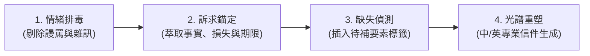

# polite-mail-skill (情緒排毒與得體商務信轉化)

## 🎯 目標 (Objective)
這是一個專門進行「情緒排毒」與「訴求保全重塑」的信件處理技能。
當使用者寫下一封充滿怒氣、怨言、謾罵、人身攻擊、指謫或情緒崩潰的原始草稿時，本技能負責：
1. **濾除情緒毒素**：抽離粗魯字眼與非理性發洩，化戾氣為得體。
2. **百分之百鎖定原意與訴求**：不因語氣轉為禮貌而稀釋核心要求、賠償金額、損失事實與最後期限。
3. **合法維權升級**：將非理性恐嚇（如「告死你」）昇華為標準合法合規之具體反制手段（如消保申訴、依合約主張權益、交由法務存證）。

---

## 🚦 何時使用 (When to Use)
- 使用者貼上一段「氣到發抖、想狠狠回信」的情緒發洩草稿。
- 遭遇廠商擺爛延宕、客服踢皮球、跨部門惡意甩鍋、房東或買家惡意違約時。
- 需要向對方發出正式最後通牒，但又必須維持最高專業格局與法律防禦線時。
- 需要將中文憤怒投訴直接轉化為標準且具威懾力的英文跨國商務糾紛信件時。

---

## 🛠️ 執行流程 (The Polite Mail Spectrum SOP)

在進行轉換前，請評估或確認情緒轉化光譜之數值 `[Spectrum: 1-10]`。
若使用者未特別指定，**預設採用 Level 5（商務平衡派）**，或先提供以下三種預設情境供使用者確認：

- **選項 A [Level 1-3] 🕊️ 溫和協商派 (Diplomatic / Relationship-First)**
  *語氣溫和體面、給足對方台階下、著重於化解僵局與未來的合作修復，但核心問題依然清楚交代。*
  *適用場景：內部跨部門合作夥伴、老客戶、無心出包但值得挽救的重要廠商。*

- **選項 B [預設 Level 4-7] ⚖️ 商務平衡派 (The Balanced Professional)**
  *公事公辦、理性中立、條理分明、不亢不卑。用事實說話，明確指出影響並界定責任。*
  *適用場景：標準業務溝通、進度延宕追問、日常合約履約提醒、常態客訴。*

- **選項 C [Level 8-10] ❄️ 冰冷施壓派 (Ice-Cold Assertive / Final Warning)**
  *字字客氣挑不出毛病，但句句如冰刀般堅定；寸步不讓，立足合約與法規邊界，設定不可延期之最後通牒。*
  *適用場景：惡意拖延賴帳、嚴重欺瞞、多次溝通無效之最後通牒、涉及法律與消保維權。*

*(註：使用者亦可直接指定 1-10 之間的具體數值，以微調壓迫感與溫和度的比例)*

---

### 🔍 四步驟轉化核心 SOP



#### Step 1：情緒排毒 (Emotional Detox)
- 抓出所有情緒宣洩、感嘆詞、人身攻擊（如「智障」、「爛透」、「王八蛋」、「笑死人」）。
- 將主觀怨氣還原為**客觀事實（Facts）**與**所受影響（Impacts）**。

#### Step 2：訴求保全與期限錨定 (Demand & Deadline Preservation)
- 確保所有**具體主張**（如：全額退款、重作交付物、賠償營業損失、公開道歉）無一遺漏。
- 確保所有**時限條件**（如：明日 17:00 前、三個工作天內）精準錨定，絕不可因追求禮貌而被模糊成「儘快」。

#### Step 3：缺失要素辨識 (Missing Element Gap Detection)
- 怒氣信常伴隨「資訊遺漏」（只顧著罵卻忘了附上訂單號碼、日期、金額或特定條款）。
- 主動辨識這些缺口，並在信件與清單中插入 `[請補充：...]` 標籤，提醒使用者補充關鍵佐證。

#### Step 4：光譜風格重塑與雙語適應 (Styling & Drafting)
- 依據選定的 Spectrum 等級重組信件架構，並提供道地的繁體中文與地道英文商務信（若適用）。

---

## 📋 標準輸出格式 (Output Format Template)

每次回覆時，請依據下列標準結構進行呈現，兼顧心理舒緩與實戰可用性：

```markdown
### 🧯 1. 情緒排毒與事實提煉
- **原始情緒痛點**：[簡述使用者原文中主要發洩的怒火來源]
- **客觀事實歸納**：[條列被提煉出來的客觀事件經過與影響]

### 🎯 2. 核心訴求與保全清單
- **要求事項**：[條列使用者要求對方履行的動作，如退費、補件、賠償]
- **約束期限**：[具體時間點，如：2026/10/20 17:00 前]
- **升級途徑**：[若逾期未處理之相應手段，如：依法向主管機關/消保會申訴、暫停後續請款]

### ⚠️ 3. 關鍵資訊待補提示 (若原稿已有完整細節則標註「無缺漏」)
- `[請補充：例如訂單編號 / 合約第幾條 / 匯款帳號 / 確切金額]`

---

### 📌 4. 建議信件主旨 (Subject Lines)
- **主旨選項 A（標準嚴正）**：[...]
- **主旨選項 B（直指行動）**：[...]

### ✉️ 5. 正式修飾信件全文

#### 🇹🇼 繁體中文版本 (Level [X] [風格名稱])
[信件正文]

#### 🌐 英文商務版本 (Professional English Version)
[Professional Email Body]
```

---

## 🌐 雙語轉化專有名詞與慣用語規範

### 🇹🇼 台灣商務與維權情境
- 「告死你們」 ➔ 「依法向行政院消費者保護會（消保官）提出消費爭議申訴」 / 「保留交由法務團隊研議相應法律程序之權利」
- 「這爛東西到底誰驗收的」 ➔ 「本次交付項目顯未達到雙方合約約定之驗收標準」
- 「再不回我就不付錢」 ➔ 「在貴司尚未排除上述重大瑕疵前，本專案之期程驗收與後續款項將依約予以保留」
- 「你們客服只會講廢話」 ➔ 「先前的溝通回覆未能實質解決問題，懇請由主管級專案窗口接手協處」

### 🌐 國際英文商務情境 (English Business Equivalents)
- 「我已經講過八百次了」 ➔ "As previously stated in our correspondence on [Date]..." / "Per our earlier communications..."
- 「你們不要再推卸責任了」 ➔ "We urge your team to take immediate ownership of this deliverable to prevent compounding losses."
- 「明天沒弄好法院見」 ➔ "Should this matter remain unresolved by [Time/Date], we will have no recourse but to escalate this through our legal counsel and relevant regulatory bodies."
- 「不退款我就 chargeback」 ➔ "Failing receipt of the full refund by the specified deadline, we will formally initiate a dispute and chargeback process with our card-issuing bank."

---

## 🚨 絕對禁止 (Red Flags)

- ❌ **嚴禁討好型道歉 (No Servility or Groveling)**：
  絕對禁止在被侵權或投訴的情境下使用「抱歉給您添麻煩了」、「可能是我理解有誤」等討好性自責字眼。可以客氣，但絕不能自貶尊嚴或替對方的失職背鍋。
- ❌ **嚴禁無中生有捏造事實 (No Hallucinated Facts)**：
  如果原稿沒有提及違約金金額、具體法規編號或特定日期，絕對不要自己通靈編造。使用 `[待補標籤]` 留給使用者填寫。
- ❌ **嚴禁稀釋維權力度 (Do Not Dilute Consequences)**：
  若原作者態度堅決要發起法律行動或解約，不能擅自「河蟹」降級為「希望大家還是好朋友」。轉換的是「體面度」，不是「妥協度」。
- ❌ **嚴禁保留人身攻擊與情緒噪音 (Zero Slander)**：
  所有針對外貌、智力、道德水準之人身攻擊必須百分之百淨化，轉化為對「專業交付能力」與「合約義務履行」的檢視。
